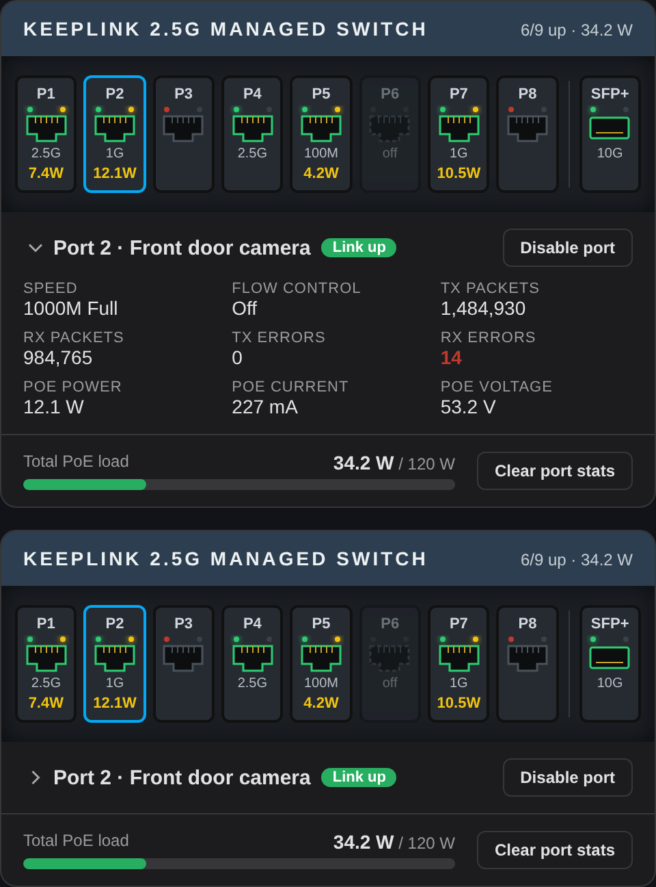

# Keeplink Switch Card

A Home Assistant dashboard card that shows a Keeplink 2.5G managed PoE switch as a faceplate: link state, speed and PoE draw per port, a collapsible details panel for the selected port, total PoE load, and a button to clear port statistics.



The preview is rendered from sample data.

## Install

1. Copy `keeplink-switch-card.js` to `/config/www/`.
2. In Home Assistant go to Settings → Dashboards → Resources and add `/local/keeplink-switch-card.js` as a JavaScript module.
3. Add the card to a dashboard:

```yaml
type: custom:keeplink-switch-card
```

## Options

All options are optional.

| Option | Default | Description |
| --- | --- | --- |
| `title` | `Keeplink 2.5G Managed Switch` | Text in the title bar |
| `prefix` | `keeplink` | Entity prefix |
| `ports` | `8` | Number of RJ45 ports, numbered from 1 |
| `sfp_ports` | `1` | Number of SFP ports, numbered after the RJ45 ports |
| `poe_budget` | `120` | Watts, sets the scale of the PoE bar |
| `details_collapsed` | `false` | Start with the port statistics folded away |
| `port_names` | none | Map of port number to a friendly name |

```yaml
type: custom:keeplink-switch-card
poe_budget: 120
port_names:
  1: NAS
  9: Uplink
```

## Entities

| Entity | Use |
| --- | --- |
| `binary_sensor.<prefix>_port_<n>_link` | Link state; attributes `speed`, `flow_control`, `tx_packets`, `rx_packets`, `tx_errors`, `rx_errors`, `poe_power_w`, `poe_current_ma`, `poe_voltage_v` |
| `switch.<prefix>_port_<n>_state` | Port enabled or disabled |
| `sensor.<prefix>_port_<n>_poe_power` | PoE draw per port |
| `sensor.<prefix>_poe_total_power` | Total PoE load |
| `button.<prefix>_clear_statistics` | Clear port statistics |
